

<picture>
  <source media="(prefers-reduced-motion: reduce)" srcset="assets/profile-hero.webp" />
  
</picture>

 

<h1>やあ! I'm Ravi Kushwaha </h1>

 

**📍 India · working worldwide** &nbsp; **🟢 Available for new projects** &nbsp; **🎌 Developer · builder · anime enjoyer**

---

## 🧑‍🚀 Character Profile

> I build whole products, end to end, on my own — from the first screen to the backend, deployment, and all the little systems that make a product work.

| ✨ Class | 🛠️ Main abilities | 🗺️ Current base | 💌 Quest requests |
|:--|:--|:--|:--|
| Android + Full-stack Engineer | Mobile · web · backend · AI | India, worldwide clients | [Send me an email](mailto:developerravi8@gmail.com) |

🎮 Open character loadout

**Mobile:** Kotlin, Java, Android Studio, Jetpack Compose, Android Views, Capacitor, Flutter, custom native plugins 
**Web & backend:** JavaScript, HTML, CSS, Node.js, Express, React, Next.js, Vite, PostgreSQL, MySQL, Redis, Bull queues, Drizzle ORM, PHP 
**AI & ML:** Python ML pipelines, LLM apps and agents, RAG / Qdrant, speech STT/TTS, GPT-SoVITS voice cloning, MCP servers 
**Infra:** AWS EC2, VPS, Docker, Dokploy, Traefik, Nginx, cPanel, Hostinger, Webmin, Sentry, PostHog

  
   
  
  

## 🌟 Main Quests · Featured Builds

<table>
  <tr>
    <td width="50%" valign="top">
      <h3>🛍️ Kissly · E-commerce</h3>
      <a href="https://kissly.in">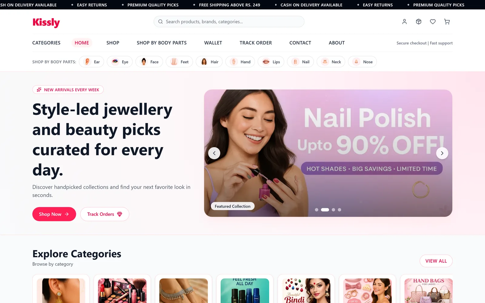</a>
      
Indian beauty, fashion, and jewellery commerce. I work as Senior Developer across the storefront, backend, and operations tooling.

      
<b>Impact:</b> 10,000+ orders processed.

      
Order state machine · Shiprocket + Shadowfax webhooks · payment links · warehouse and returns workflows · off-site backups.

      
<b>Stack:</b> PHP · Node.js · MySQL · Razorpay · PM2 · Backblaze B2

      <a href="https://kissly.in">Store</a> · <a href="https://kisslybeauty.in">Beauty</a> · <a href="https://play.google.com/store/apps/details?id=com.kissly">Android app</a>
    </td>
    <td width="50%" valign="top">
      <h3>🌸 AyraVerse · AI Anime Companion</h3>
      <a href="https://ayraverse.com">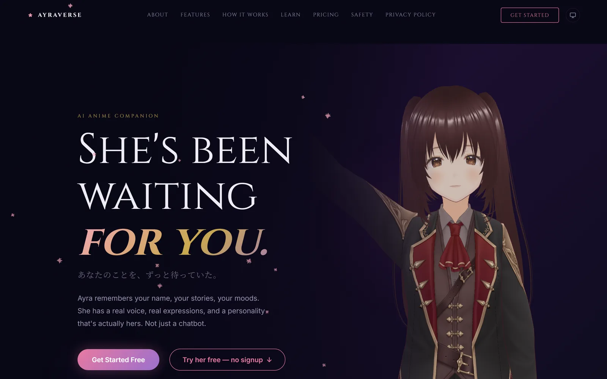</a>
      
A voice-first AI companion with an expressive 3D avatar, long-term memory, and live YouTube co-watching.

      
<b>Highlights:</b> speech → LLM → cloned-voice TTS · VRM lip-sync · Qdrant memory · timestamped watch-party reactions · custom Android audio plugins.

      
<b>Stack:</b> React · Vite · Three.js · Node.js · PostgreSQL · Redis · Qdrant · GPT-SoVITS · Capacitor

      <a href="https://ayraverse.com">Meet Ayra</a> · <a href="https://prismatic.ayraverse.com">Prismatic 3D concert</a>
    </td>
  </tr>
  <tr>
    <td width="50%" valign="top">
      <h3>🧪 Zevian · SEO CI for Developers</h3>
      <a href="https://zevian.tech">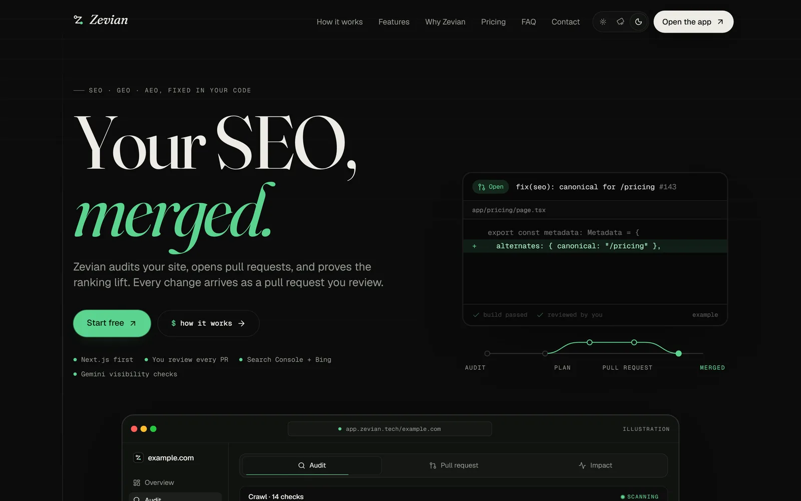</a>
      
Audits a site, opens GitHub pull requests with fixes, then measures search impact through Google Search Console and Bing. Checks AI search visibility too.

      
<b>Highlights:</b> automated fix PRs · search impact reporting · MCP server published as <code>zevian-mcp</code>.

      
<b>Stack:</b> Next.js · TypeScript · GitHub API · Search Console API · MCP

      <a href="https://zevian.tech">Explore Zevian</a> · <a href="https://www.npmjs.com/package/zevian-mcp">npm package</a>
    </td>
    <td width="50%" valign="top">
      <h3>🎼 Prismatic · 3D Audio-Reactive Concert</h3>
      
A browser-native 3D concert experience that reacts to audio, built with Three.js and part of the AyraVerse universe.

      
<b>Stack:</b> Three.js · Web Audio · browser graphics

      <a href="https://prismatic.ayraverse.com">Enter Prismatic Arena ↗</a>
    </td>
  </tr>
  <tr>
    <td colspan="2" valign="top">
      <h3>🪄 Arcvelt · AI Coding-Agent Command Center</h3>
      <a href="https://arcvelt.com">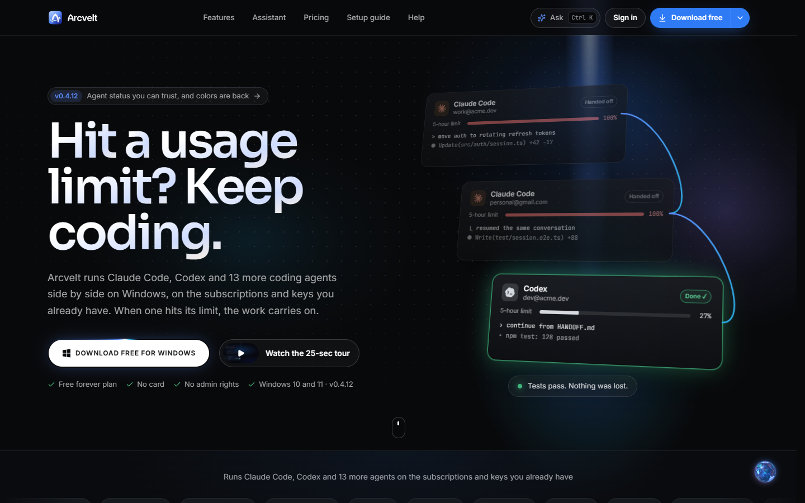</a>
      
A Windows desktop workspace for running Claude Code, Codex, and other CLI agents side by side. It tracks usage and keeps sessions moving when account limits hit.

      
<b>Highlights:</b> quota-aware account switching · conversation handoff · wait and resume at reset · embedded terminals · editor, source control, browser, token saver · Android phone remote.

      
<b>Stack:</b> Tauri 2 · Rust · React · TypeScript · Vite · Tailwind CSS · SQLite · Flutter

      <a href="https://arcvelt.com">Explore Arcvelt</a> · <a href="https://arcvelt.com/get-app">Android companion</a>
        
      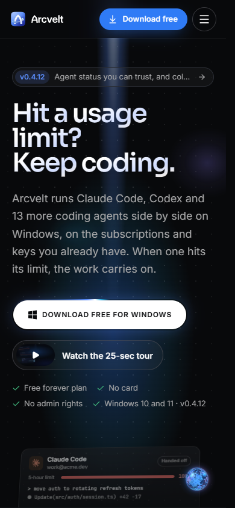
    </td>
  </tr>
</table>

## 🧭 Side Quests · More Shipped Work

<table>
  <tr>
    <td width="50%" valign="top">
      <h3>🎧 Tarang Music · Android</h3>
      
A music player with background playback, queues, playlists, synced lyrics, and recommendations. Streams without its own server.

      
<b>Stack:</b> Kotlin · Jetpack Compose

      <i>App screenshots are still pending.</i>
    </td>
    <td width="50%" valign="top">
      <h3>🏏 Tapori Cricket · Android Game</h3>
      <a href="https://play.google.com/store/apps/details?id=com.taporicrickethitscore">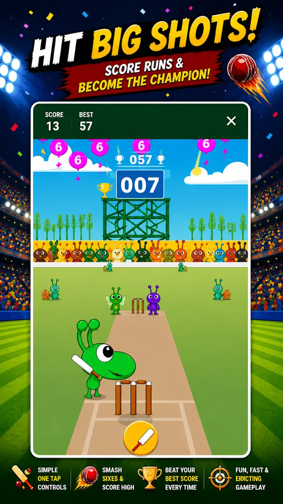</a>
      
Street-style mobile cricket game.

      
<b>Stack:</b> Kotlin · Jetpack Compose

      <a href="https://play.google.com/store/apps/details?id=com.taporicrickethitscore">Play Store ↗</a>
    </td>
  </tr>
  <tr>
    <td width="50%" valign="top">
      <h3>🏗️ V T Pardeshi &amp; Sons · Client Website</h3>
      <a href="https://vtpardeshiandsons.in/">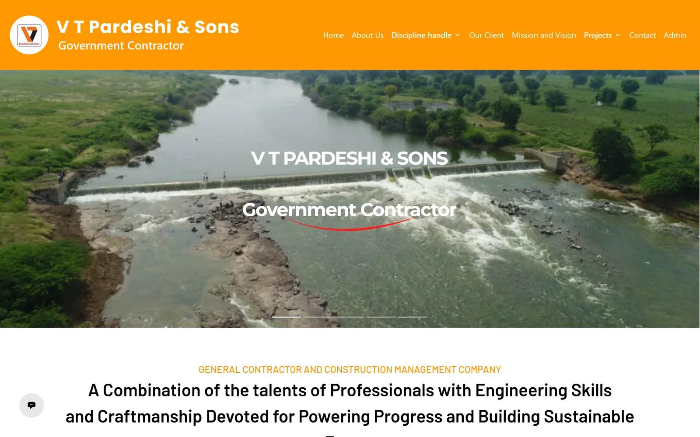</a>
      
Showcases ongoing and completed government civil projects, with 20+ government client listings and an admin panel.

      
<b>Stack:</b> PHP · MySQL

      <a href="https://vtpardeshiandsons.in/">Visit site ↗</a>
    </td>
    <td width="50%" valign="top">
      <h3>💍 Community Matrimony · Web</h3>
      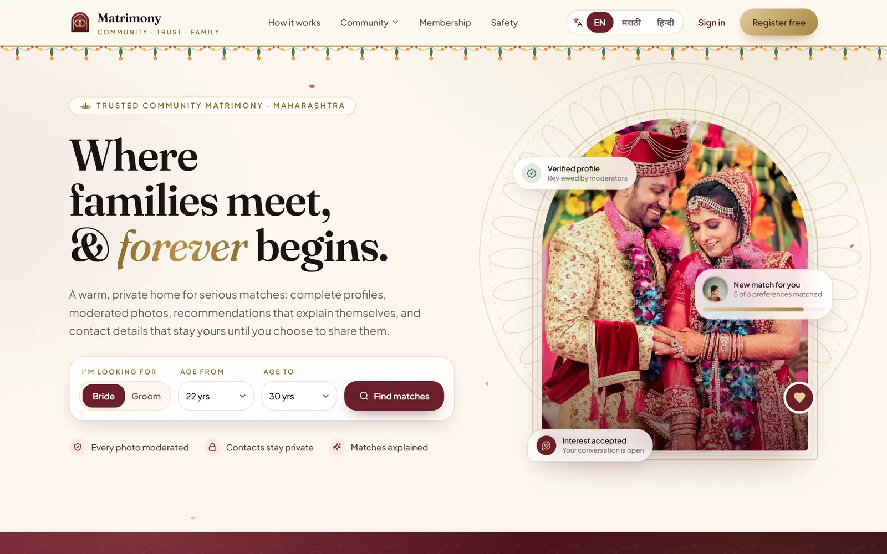
      
Maharashtra community matchmaking with profiles, filters, moderated photos, explainable match recommendations, and private contact details.

      
<b>Stack:</b> TypeScript

      <i>Private deployment · no public URL</i>
    </td>
  </tr>
  <tr>
    <td width="50%" valign="top">
      <h3>🧾 OkBill POS · Billing Platform</h3>
      <a href="https://okbillpos.in">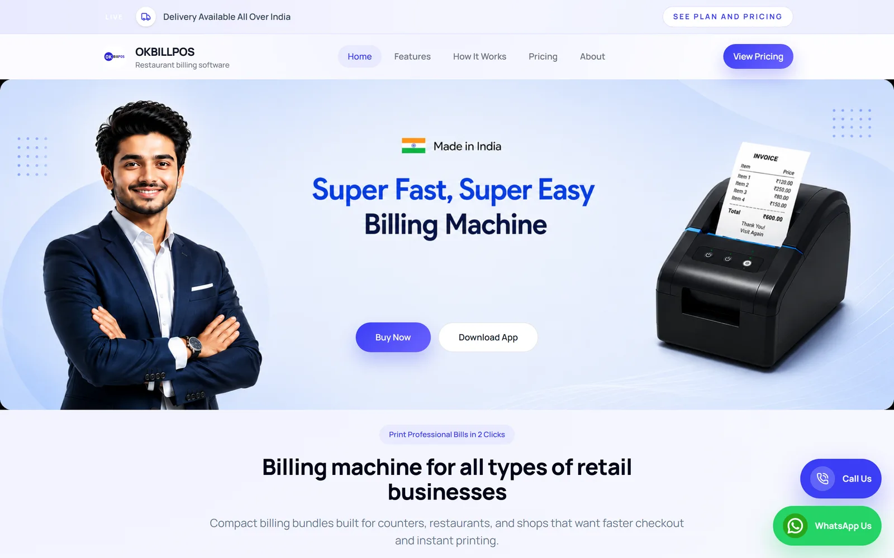</a>
      
Restaurant and retail billing with POS and thermal-printer support. Includes the product site, store, admin panel, CRM, and worker desk.

      
<b>Stack:</b> React · Vite · Tailwind · PHP · MySQL

      <a href="https://okbillpos.in">Visit OkBill ↗</a>
    </td>
    <td width="50%" valign="top">
      <h3>📊 Play Store Intelligence · Private</h3>
      
A Python pipeline that collects and structures Play Store app data for market and competitor analysis.

      
<b>Stack:</b> Python

      <i>Private project · no public URL</i>
    </td>
  </tr>
</table>

## 🧙‍♂️ The Lab · Experiments

| Project | What it does | Status |
|:--|:--|:--|
| 🎞️ Reference-to-video agent | Finds similar videos from a reference and generates new videos in that style. | Experimental |
| 🌌 Parallax AI | Turns one image into an AI-segmented 2.5D Android live wallpaper. | Prototype |
| 🎙️ Custom voice models | Trained voice-cloning models served on serverless GPUs for real-time speech. | Research |

## 📈 GitHub Arc · Stats & Activity

  
  

  

  <a href="https://github.com/DeveloperRavi8/DeveloperRavi8/tree/output/activity">
    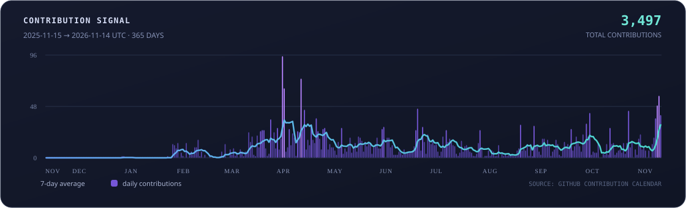
  </a>

<a href="https://raw.githubusercontent.com/DeveloperRavi8/DeveloperRavi8/output/activity/activity-30d.svg">30 days</a> · <a href="https://raw.githubusercontent.com/DeveloperRavi8/DeveloperRavi8/output/activity/activity-90d.svg">90 days</a> · <a href="https://raw.githubusercontent.com/DeveloperRavi8/DeveloperRavi8/output/activity/activity-365d.svg">365 days</a>

Stats reflect GitHub activity visible to these services; they don't represent every project or client contribution.

## 🐍 Contribution Snake · Ultimate Move

  <picture>
    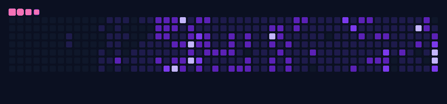
  </picture>

<a href="https://github.com/Platane/snk">Generated daily from my contribution graph with Platane/snk</a>

## ☕ End Credits

Got a product idea, a tricky Android problem, or an AI companion concept? I’m available for new projects and work with clients worldwide.

  
  
  

**Thanks for scrolling all the way down. May your builds be green and your anime queue never-ending!** ✨

